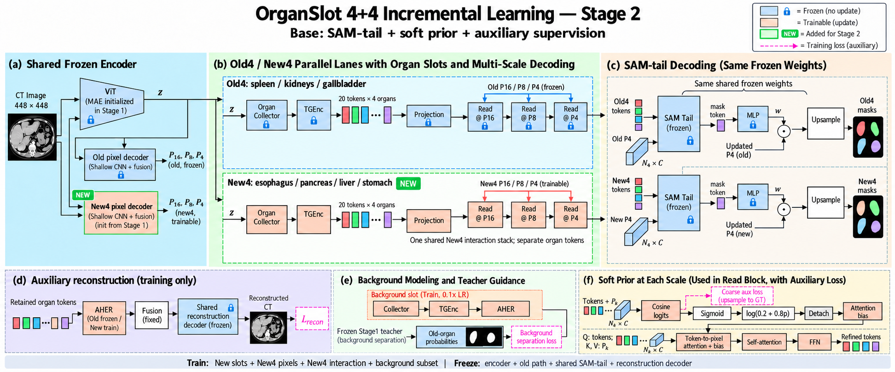
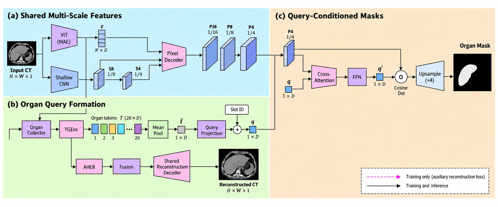
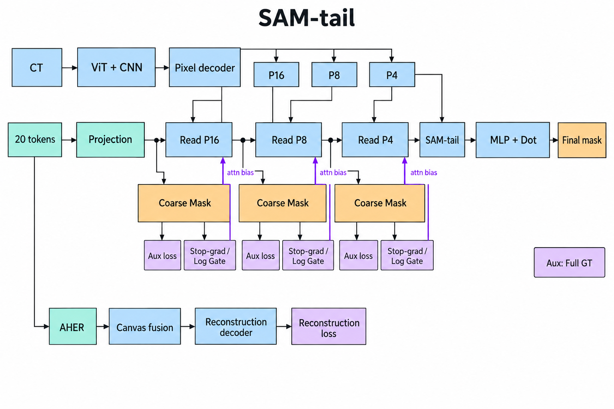
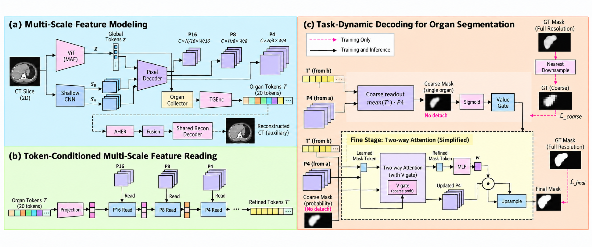

# OrganSlot

文档导航：[docs/README](docs/README.md)；完整正负结果：[消融台账](docs/RESULTS.md)。

开发中的 E cross / SAM-tail 编码器对照：[nnU-Net ResEnc / MedNeXt-B 2D](docs/CONFIGURATION.md#cnn编码器与autopet迁移)。
仅替换 backbone，CPU验证已通过；2026-10-13已提交两条AutoPET预训练及四条SAM-tail迁移训练依赖链，尚无分割成绩，不计入下方正式指标。

共享ViT＋器官独立tokens＋共享空间分支的分割/重建框架。后续仅保留以下三个2D主线配置。
架构图为按代码绘制的AI生成示意图，PNG供GitHub预览，PDF供下载；不是SAM/H-SAM官方复刻。
使用内置image_gen生成（工具未提供image2.5版本选择）；[重绘提示词记录](docs/figures/redraw_prompts.json)。
采用纯白、柔和配色、英文短标签的扁平矢量风格；文件本身仍是栅格图，PDF非可编辑矢量。

## 三个配置的正式指标

### 当前4＋4增量架构与消融（2026-10-26）

最新完成：**SAM新四类独立pixel decoder＋新四类共享交互**，训练/评估
`167611 / 167612`，sifansong/XEC。最终checkpoint-802，118800次Stage2更新；
固定0.5后处理Old4/New4/All8＝**86.78/80.68/83.73**，验证集校准后＝
**87.12/81.07/84.09**。冻结参数审计`match=true`。

#### 架构：新增什么，训练什么

Stage1使用AutoPET MAE encoder初始化ViT，训练旧四类与背景；Stage2从完整Stage1
`156536/checkpoint-802.pth`初始化，保留冻结teacher，加入新四类slots。
旧类为脾脏、右肾、左肾、胆囊；新类为食管、胰腺、肝脏、胃。共8个器官slot＋背景slot。



基于下方原始SAM soft prior＋aux图重绘。蓝色/锁表示冻结，桃色表示训练，绿色NEW表示
Stage2新增。图中两处SAM-tail使用同一套冻结权重；P16/P8/P4标注为对应pixel decoder
的输入引用，省略跨面板长连线。背景与重建模块为概略表示，完整训练范围见下表。
本图使用内置imagegen生成；工具未提供具体模型版本选择，不能确认image2版本。


图中下方补充重建与背景路径，冻结矩阵如下。新空间分支从Stage1复制，含空间解码器内部
浅层CNN和多尺度融合；输出P16/P8/P4。新类共享一套复制的投影与三层交互，依次读取
P16→P8→P4；各器官独立产生soft prior并接受coarse aux监督。
最后仍经共享冻结SAM-tail生成mask权重并与对应P4点积。
**这组没有复制或解冻SAM-tail，也没有启用residual16或adapter32。**

| 模块 | Stage1 | 当前Stage2 | 新增/路由方式 |
|---|---|---|---|
| ViT encoder | MAE初始化后训练 | 冻结 | 新旧共享encoder输出 |
| 原pixel decoder及其浅层CNN | 训练 | 冻结 | 旧类继续读取原空间特征 |
| 新四类pixel decoder | 不存在 | **训练** | 从Stage1复制，一套供新四类共享；391872参数 |
| 旧四类Collector/TGEnc/token_norm/AHER及slot侧参数 | 训练 | 冻结 | 保留旧类路径 |
| 新四类slots | 不存在 | **训练** | 按现有背景初始化规则扩展；校准scale/bias冻结 |
| 旧类投影/三层token交互 | Stage1共享训练 | 冻结 | 迁移为旧类私有副本 |
| 新四类投影/三层token交互 | 不存在 | **训练** | 从Stage1复制，新四类共用一套892928参数交互 |
| soft prior | 动态计算 | 动态计算 | 每器官独立计算；公式共享，无额外先验网络 |
| SAM-tail：mask token、双向attention、FFN、最终MLP | 训练 | 冻结 | 新旧共享权重；forward仍对输入可微 |
| 共享重建decoder | 训练 | 冻结 | 新类AHER仍经原重建路径学习 |
| 背景Collector/TGEnc/token_norm/AHER | 训练 | **0.1倍LR训练** | separation策略；背景head/交互/校准冻结 |
| Stage1 teacher | 不适用 | 全部冻结 | 提供旧类概率，辅助背景分离 |

#### 实际训练与评估配置

| 项目 | 当前正式任务配置 |
|---|---|
| 数据 | WORD官方池seed42：96训练/26验证/24测试；测试7315切片；模型seed0 |
| 阶段数据权限 | 两阶段复用相同训练病例；Stage1仅旧类GT，Stage2仅新类GT；不访问旧类GT，保留Stage1 teacher |
| 输入/spacing | 2D 448×448；0.7×0.7×2.0 mm；每器官20 tokens，交互channels128，pixel PE none |
| 预算 | Stage1、Stage2各118800 optimizer updates；warmup各5940；总237600，并非与Offline等总算力 |
| Stage2资源 | sifansong/XEC，account=sifansong，QoS=8gpus；2×RTX4090，12CPU，192GB，5天 |
| batch | 每卡16×2卡×累积6＝192；Stage1/此前四卡组为16×4×3＝192 |
| 优化器 | AdamW，LR 7.5e-5，betas=(0.9,0.95)，weight decay0.05；背景LR 7.5e-6 |
| 数值策略 | BF16；gradient clip1.0；每50步有限值检查 |
| 采样 | organ ROI概率0.2，ROI crop384，中心扰动0.1；ROI目标强制保留；TGR legacy_batch |
| 分割监督 | small_organ loss；retained新类监督；lambda_seg0.01；aux相对系数0.25 |
| 背景监督 | separation；lambda_background0.1；preserve_weight0.1；teacher低/高阈值0.1/0.9 |
| 评估 | 固定0.5与验证集校准分别报告；统一后处理；head与reconstruction分别评估；单卡RTX4090 |

损失结构：`Lrecon + 0.01 × (Lfinal_new + 0.25 × mean(Lcoarse16, Lcoarse8, Lcoarse4)) + 0.1 × Lbgsep`。
soft prior使用`log(0.2 + 0.8 * sigmoid(coarse.detach()))`作为token→pixel注意力偏置；
coarse logits上采样后接受GT监督。本配置不是缩小GT监督组合。

两卡与四卡虽然有效batch相同，legacy_batch下每次更新的器官保留组合数不同；
同时，本次将新类交互由每slot独立改为新四类共享。因此下面是路线对照，
不能把提升全部归因于“仅新增pixel decoder”。

#### 增量消融与PCDD参考

下表均为校准后＋后处理Dice（%）；不同架构、Stage1、硬件/采样组合的差异须一起考虑。

| 实验 | Stage2改动与目的 | 训练/评估Job | Old4 | New4 | All8 | 观察 |
|---|---|---|---:|---:|---:|---|
| E query_shared | 冻结空间，训练新旧共享query投影/cross-attn/FFN | 3044537/3044538 | 19.14 | 67.17 | 43.16 | 旧类严重遗忘 |
| E query_split | 冻结空间与旧读出，新四类独立一套query交互 | 3044539/3044540 | 87.09 | 67.41 | 77.25 | 保护旧类，但新类学习仍弱 |
| SAM slot_private | 冻结空间/tail；每新器官独立三尺度交互 | 156538/156539 | 87.12 | 76.57 | 81.84 | 相对E路线更好；非单因素对照 |
| SAM slot_private＋residual16 | 新类共用4240参数mask权重adapter | 157119/157120 | 87.12 | 76.65 | 81.88 | 仅+0.04 All8，单次证据不足以支持稳定收益 |
| **SAM新四类pixel decoder＋共享新交互** | 新类空间与交互一起适配；旧路径冻结 | **167611/167612** | **87.12** | **81.07** | **84.09** | 相对SAM私有交互New4+4.50、All8+2.25 |
| SAM slot_private＋spatial adapter32 | 保留冻结空间，新增58400参数空间残差；保留每slot交互 | 171087/171088 | — | — | — | 2026-10-26仍训练，尚无性能结论 |
| PCDD论文4–4参考 | 论文方法，未复现同病例/预处理协议 | 论文Table 2 | 84.09 | 82.75 | 83.42 | 外部参考，不是严格公平排名 |
| **对应架构Offline：SAM soft prior＋aux** | 八类联合训练；旧24例划分，训练集校准 | **150971** | **86.94** | **84.17** | **85.55** | 架构对应，但划分与校准来源不同，不能直接量化增量损失 |
| 对应架构、同协议Offline SAM | 官方池seed42＋验证集校准 | 待核验/补齐 | — | — | — | 严格增量基线尚未补齐 |
| 同划分参考：Offline E cross＋MAE | 官方池seed42；不同架构 | 2998655 | 87.84 | 83.45 | 85.64 | 仅作同病例参考，不是当前SAM的对应Offline基线 |

PCDD来源：[AAAI论文Table 2](https://ojs.aaai.org/index.php/AAAI/article/download/38406/42368)。
当前结果相对PCDD报告值Old4+3.03、New4−1.68、All8+0.67个百分点；
不据此宣称同协议超过PCDD。冻结参数审计通过；旧类固定阈值二值Dice差异仅
0.00062个百分点，不等于互斥多类输出严格不变。

**当前增量设计的对应Offline架构是SAM-tail＋soft prior＋aux。**
已记录的150971使用旧24例划分及训练集校准，当前增量使用官方池seed42及验证集校准。
以下并列展示实际结果，不计算跨协议差值；Old4/New4由已显示的逐器官数值平均，存在舍入误差。

| 新类 | 对应架构Offline SAM（旧划分） | 同划分参考Offline E（seed42） | SAM私有交互（seed42） | 当前新空间＋共享交互（seed42） |
|---|---:|---:|---:|---:|
| 食管 | 78.47 | 71.72 | 63.79 | 71.13 |
| 胰腺 | 76.46 | 78.91 | 66.75 | 73.69 |
| 肝脏 | 95.30 | 95.72 | 94.51 | 95.23 |
| 胃 | 86.43 | 87.43 | 81.23 | 84.22 |
| New4均值 | 84.17 | 83.45 | 76.57 | 81.07 |

此前“New4差2.38个百分点”是相对同划分Offline E的差值，**不是相对对应SAM架构的增量损失**。
不能把85.55与84.09的跨划分差值解释为冻结模块带来的退化。
当前能够直接观察到的是：相对同划分SAM私有交互，新空间＋共享交互的New4提升4.50个百分点。
冻结encoder与tail是否限制新类适配仍是待验证假设，需要同架构、同划分、同校准协议的Offline结果。
历史只训练slot、共享空间整体解冻等探索及协议限制保留在[增量台账](docs/INCREMENTAL_READOUT_ABLATION.md)，
未核验同口径数值的实验不填入本表。

#### 启动入口与证据

在已分配GPU、已固定源码版本的环境设置账号路径后运行：

```bash
export INCREMENTAL_ARCHITECTURE=sam_soft_aux
export BACKGROUND_POLICY=separation
export STAGE2_SHARED_SEGMENTATION=slot_private
export STAGE2_PIXEL_DECODER=new4 STAGE2_READOUT_ADAPTER=none
export INCREMENTAL_NPROC_PER_NODE=2 ARM_F_MICRO_BATCH=16 ARM_F_ACCUM_ITER=6
# 设置 PYTHON_BIN、WORD_ROOT、OUTPUT_DIR、STAGE1_CHECKPOINT；输出使用新目录。
bash scripts/orgslot/run_incremental44.sh stage2 --save_freq 10
```

提交入口：[Stage2 Slurm](slurm/orgslot/train/incremental44_stage2_sip.sbatch)、
[统一评估](slurm/orgslot/eval/incremental44_stage2.sbatch)；评估设`EVALUATE_RECONSTRUCTION=1`，
依赖`afterok:训练Job`。Slurm资源以账号/QoS实际允许值覆盖脚本默认值。
新提交先通过`tools/check_experiment_revision.sh`，使用独立不可变runtime。

本次结果对应历史源码`365dc78d2185a8e36161b99a3d49977919db7768`，
runtime=`sifansong/XEC:/gpfs/work/aac/sifansong/worktrees/inc44_2gpu_365dc78`；
当前开发代码包含该架构及后续adapter32，不能把文档提交号当成历史训练版本。
证据根目录：`sifansong/XEC:/gpfs/work/aac/sifansong/artifacts/inc44_new4_2gpu_20261021/`：

- `stage2_separation_167611/resolved_config.json`：实际参数；`freeze_audit.json`：epoch802冻结审计。
- `stage2_separation_167611/checkpoint-802.pth`：最终模型。
- `evaluation/stage_comparison.json`：Stage1/Stage2分组及逐器官结果。
- `evaluation/test/results.json`：完整head结果；`evaluation/reconstruction/results.json`：独立重建结果。
- `167611.out`：训练日志。远端Git保存代码/文档，不包含上述大模型与集群产物。

### 最新汇总：E cross＋MAE三次同协议随机划分（2026-10-08）

**主指标：固定0.5平均Dice 85.62%，验证集校准平均Dice 86.22%。**
使用官方池划分seed0/1/42，分别独立训练；每次96例训练、26例验证、24例测试，
模型seed均为0。以下为三次八类病例Dice均值的等权算术平均，不合并重复病例。
这是重复随机划分评估，不是三折交叉验证：seed0/1、0/42、1/42分别有13、10、11例
共同测试病例。旧划分及替换5病例的探索性评估不纳入主均值。

| E cross＋MAE encoder配置 | 训练Job | 测试病例／切片 | 阈值校准数据 | 固定0.5 | 校准后 |
|---|---|---|---|---:|---:|
| 官方池seed42 | 2998655，bolinren19/SIP | 24／7315 | 独立26例验证集 | 84.95 | 85.64 |
| 官方池seed0 | 3006796，bolinren19/SIP | 24／6854 | 独立26例验证集 | 85.20 | 85.57 |
| 官方池seed1 | 3006797，bolinren19/SIP | 24／7079 | 独立26例验证集 | 86.71 | 87.44 |
| **官方池三次划分平均（同协议）** | seed42/0/1等权 | 非互斥测试集 | 验证集校准 | **85.62** | **86.22** |

八类校准Dice：

| 器官 | 旧划分 | seed42 | seed0 | seed1 |
|---|---:|---:|---:|---:|
| 脾脏 | 94.74 | 94.07 | 94.71 | 94.92 |
| 右肾 | 94.62 | 93.72 | 94.22 | 95.21 |
| 左肾 | 94.46 | 93.93 | 94.52 | 94.69 |
| 胆囊 | 62.34 | 69.63 | 69.92 | 74.64 |
| 食管 | 78.00 | 71.72 | 70.80 | 75.40 |
| 胰腺 | 77.29 | 78.91 | 77.39 | 80.91 |
| 肝脏 | 95.29 | 95.72 | 95.67 | 96.17 |
| 胃 | 86.13 | 87.43 | 87.34 | 87.61 |

### SOTA数值汇总（按展示值降序，协议不同，不是公平胜负排名）

| 方法 | 校准Dice展示值 | 汇总口径 |
|---|---:|---|
| E cross＋MAE encoder | **86.22** | 官方池seed0/1/42三次同协议随机划分平均 |
| SAM soft prior＋aux | 85.55 | 旧划分单次，尚未完成相同三次划分 |
| SAM两阶段mask、缩小GT监督 | 85.23 | 旧划分单次，尚未完成相同三次划分 |

不能凭这张混合协议汇总表断言E优于SAM。严格同旧划分的E仍为85.36，
下方消融排序保留原单次值。PCDD Offline85.47是外部论文参考，未核实相同
病例划分，不能据86.22宣称同协议超过。正式方法比较应使用所有方法相同
划分集合的均值。

单列记录（不参与上述均值）：旧划分训练148833固定84.30%、校准85.36%，
采用训练集前6000切片校准；替换5个badcase的评估复用该checkpoint，
属于测试病例组成的探索性分析，不是独立重训，也不纳入主排序。

结果来源：旧划分路径见下方；seed42为仓库根
`artifacts/offline_eval_recovery_20261005/evaluation/ArmE_CrossAttn_MAEenc_Official96_2998655_heads_test/results.json`；
seed0/1为`.worktrees/offline_splits_d553bc7/Results/OrganSlotBank/evaluation/Common8/WORD_2D/ArmE_CrossAttn_MAEenc_Official96_{3006796,3006797}_heads_test/results.json`。
均读取`binary_post/selected_post.foreground_mean_case_dice_presence_mean`的未舍入值求平均。

### 旧划分同协议比较

**旧24例测试划分、6990张切片、checkpoint-802、MAE encoder-only**。Dice单位%，
按病例计算再按八个前景器官平均，固定/校准结果均后处理。校准使用训练集前6000切片，
不是测试GT调参，也不是独立验证集校准。单seed，不能据微小差距声称稳定优势。

| 主线 | 固定0.5 | 校准后 | 训练Job / 账号集群 |
|---|---:|---:|---|
| E cross-attention | 84.30 | 85.36 | 148833 / sifansong-XEC |
| SAM-tail＋soft prior＋aux | **84.86** | **85.55** | 150971 / sifansong-XEC |
| SAM-tail＋两阶段mask、缩小GT监督 | 84.41 | 85.23 | 2998657 / bolinren19-SIP |

| 器官（校准后） | E cross | SAM soft prior＋aux | SAM 缩小GT |
|---|---:|---:|---:|
| 脾脏 | 94.74 | 94.74 | **94.83** |
| 右肾 | 94.62 | 94.43 | **94.66** |
| 左肾 | 94.46 | 94.45 | **94.47** |
| 胆囊 | 62.34 | **64.15** | 61.59 |
| 食管 | 78.00 | 78.47 | **78.50** |
| 胰腺 | **77.29** | 76.46 | 76.73 |
| 肝脏 | 95.29 | 95.30 | **95.32** |
| 胃 | 86.13 | **86.43** | 85.77 |
| 平均 | 85.36 | **85.55** | 85.23 |

soft prior＋aux相对E主要改善胆囊，胰腺并未全面改善。核验来源为以下目录的
`results.json`（`complete_split=true`，`binary_post/selected_post`）：

- E：`sifansong/XEC:/gpfs/work/aac/sifansong/worktrees/e_cross_mae_9791e87/Results/OrganSlotBank/evaluation/Common8/WORD_2D/ArmE_CrossAttn_MAEenc_148833_ckpt802_heads_test/`
- soft prior＋aux：`sifansong/XEC:/gpfs/work/aac/sifansong/worktrees/sam_soft_aux_2b5aa2f/Results/OrganSlotBank/evaluation/Common8/WORD_2D/ArmF_2D_150971_ckpt802_heads_test/`
- 缩小GT：`bolinren19/SIP:.worktrees/quota_recovery_b5a4792/Results/OrganSlotBank/evaluation/Common8/WORD_2D/ArmF_2D_2998657_ckpt802_heads_test/`

**新划分单列**：官方池96训练/26验证/24测试（seed42），E cross＋MAE固定84.95%、
验证集校准85.64%，7315测试切片，训练2998655。不混入上表。
PCDD Offline85.47%、4–4增量83.42%只是不同协议的外部参考，不是同病例、同预处理的复现比较。
完整历史见[RESULTS](docs/RESULTS.md)。

## 三张架构图与差异

以下为Offline联合训练结构。每个器官独立Collector/TGEnc/AHER；共享ViT、浅层CNN、
pixel decoder、读出和重建decoder。448输入下P16/P8/P4边长28/56/112；P4边长1/4、面积1/16。
SAM图重点展开分割decoder，共用的ViT、Collector和重建路径省略处与E一致，未删除模块。

### 1. E cross-attention



[下载PDF](docs/figures/architecture_e_cross.pdf)

`slot_head_type=arm_e_multiscale_query`，`query_refinement=cross_attn`，`hsam_supervision=none`。
20 tokens经query_norm、mean pool、query_proj及slot identity变成1个query；读取P4，经FFN后
与原P4点积生成mask。没有20-token逐尺度交互，也没有SAM-tail。
代码：[OrganSlotEmbed.py](OrganSlotEmbed.py)的`MultiScalePixelQueryDecoder2D`。

启动配置（先执行下方公共环境准备，再用公共`sbatch`命令提交）：

```bash
export HSAM_SUPERVISION=none
TRAIN_SCRIPT=slurm/orgslot/train/arm_e_crossattn_mae_encoder.sbatch
```

### 2. SAM-tail＋soft prior＋aux



[下载PDF](docs/figures/architecture_sam_soft_prior_aux.pdf)

`slot_head_type=arm_f_sam_tail`，`query_refinement=none`，`hsam_supervision=soft_prior_aux`。
20 tokens依次读取P16→P8→P4。每次读取前，用当前tokens归一化均值与该尺度pixels
余弦读出粗logits，`log(0.2+0.8*sigmoid(logits.detach()))`作为attention-score bias。
三张粗logits上采样至完整GT大小，辅助loss取均值；路由detach，aux保留梯度。
之后SAM-tail用mask token、双向交互、最终回读及MLP动态点积生成最终mask。
**此模式不会将粗mask传入tail内部作为prior**。
分割目标：`0.01 × (L_final + 0.25 × mean(L_P16,L_P8,L_P4))`。

启动配置：

```bash
export HSAM_SUPERVISION=soft_prior_aux
TRAIN_SCRIPT=slurm/orgslot/train/sam_tail_soft_prior.sbatch
```

### 3. SAM-tail＋两阶段mask、缩小GT监督



[下载PDF](docs/figures/architecture_sam_downsample_gt.pdf) · [三图合并PDF](docs/figures/organslot_three_architectures.pdf)

`slot_head_type=arm_f_sam_tail`，`query_refinement=none`，`hsam_supervision=downsample_gt`。
20 tokens完成不带mask引导的P16→P8→P4交互后，先与P4生成112×112粗mask。
GT最近邻缩小后监督粗mask；其sigmoid概率不detach，门控SAM-tail两次token读取中的
投影V，不重新归一化attention。最终mask上采样并使用完整GT。
分割目标：`0.01 × [w(e)L_final + (1-w(e))L_coarse]`，`w(e)=0.6^(0.990^e)`。
监控`hsam_lost_positive_slices`，检查缩小GT是否丢失小阳性区域。
这里“两阶段”是**一次forward中的粗到精解码**，不是增量训练Stage1/Stage2。
实现：[ArmFDecoder.py](ArmFDecoder.py)、[hsam_supervision.py](hsam_supervision.py)。

启动配置：

```bash
export HSAM_SUPERVISION=downsample_gt
TRAIN_SCRIPT=slurm/orgslot/train/arm_f_sam_tail_hsam.sbatch
```

| 差异 | E cross | SAM soft prior＋aux | SAM 缩小GT |
|---|---|---|---|
| 交互tokens | pool后的1个query | 20个tokens | 20个tokens |
| 交互尺度 | P4 | P16→P8→P4 | P16→P8→P4 |
| mask引导位置 | 无 | 三尺度attention logits | tail两次token读取的V |
| 粗监督 | 无 | 三尺度logits放大后监督 | P4大小的缩小GT监督 |
| 最终读出 | query · 原P4 | mask-token MLP · 更新后P4 | mask-token MLP · 更新后P4 |

## 公共配置与启动

| 配置项 | 2D Offline主线 |
|---|---|
| 数据 / spacing / ROI | WORD八类＋背景slot；0.7×0.7×2.0；448输入、384 ROI、概率0.2 |
| tokens / channels | 每slot20 tokens；pixel channels128 |
| 初始化 / seed | AutoPET MAE encoder-only，其它随机初始化；seed0 |
| 更新 / warmup | 118800 / 5940 |
| batch | 16/卡 × 4GPU × 累积3 = 192 |
| 优化 | AdamW，LR7.5e-5，weight decay0.05，clip_grad1，BF16及局部FP32 |
| 分割监督 | retained slots；small-organ loss；lambda_seg0.01、lambda_bg_seg0 |
| 阳性切片loss | Tversky(FP0.3/FN0.7)＋0.5 BalancedFocal；alpha0.75、gamma2 |
| 阴性切片loss | top2% hard-negative BCE，权重0.1 |
| 重建 | 保留原有重建与感知目标，三种head均不删除重建分支 |

以下为 **sifansong/XEC旧划分复现示例**。E脚本固定此账号路径，不能原样跨账号使用；
每个账号必须核对Python、WORD、ROI、LPIPS和MAE文件。先准备最新干净的固定runtime。

```bash
export EXPERIMENT_WORKDIR=/absolute/path/to/pinned/runtime
bash "$EXPERIMENT_WORKDIR/tools/check_experiment_revision.sh" "$EXPERIMENT_WORKDIR"
export ARM_F_TARGET=sifan-xec
export ARM_F_COMMIT=$(git -C "$EXPERIMENT_WORKDIR" rev-parse HEAD)
export MAE_INIT_CHECKPOINT=/gpfs/work/aac/sifansong/Results/AutoPET_MAE/MAE_LA6D8_224_M75_U100K_seed0/checkpoint-final.pth
mkdir -p "$EXPERIMENT_WORKDIR/logs"

# 三选一：E cross
export HSAM_SUPERVISION=none
TRAIN_SCRIPT=slurm/orgslot/train/arm_e_crossattn_mae_encoder.sbatch

# 或：SAM soft prior + aux
# export HSAM_SUPERVISION=soft_prior_aux
# TRAIN_SCRIPT=slurm/orgslot/train/sam_tail_soft_prior.sbatch

# 或：SAM两阶段缩小GT
# export HSAM_SUPERVISION=downsample_gt
# TRAIN_SCRIPT=slurm/orgslot/train/arm_f_sam_tail_hsam.sbatch

sbatch --parsable --account=sifansong --partition=gpua8001t --qos=8gpus \
  --nodes=1 --ntasks=1 --gres=gpu:a800:4 --cpus-per-task=20 --mem=192G \
  --time=5-00:00:00 --export=ALL --chdir="$EXPERIMENT_WORKDIR" \
  --output="$EXPERIMENT_WORKDIR/logs/%j.out" --error="$EXPERIMENT_WORKDIR/logs/%j.err" \
  "$EXPERIMENT_WORKDIR/$TRAIN_SCRIPT"
```

提交前记录SHA、runtime、账号和manifest；远端archive须核验校验和。不得更新运行快照。
新96/26/24划分使用[独立入口](docs/CONFIGURATION.md#word-official96-protocol)，不混用上述旧划分。

### 推理

[统一head＋recon脚本](slurm/orgslot/eval/arm_e_mae_unified.sbatch)需要设置
`EVAL_WORKDIR`、`RUN_NAME`、`ACCOUNT_ROOT`、`DATA`、`PYTHON`、`EXPECTED_SLOT_HEAD_TYPE`。
E运行名`ArmE_CrossAttn_MAEenc_JOB`；SAM运行名`ArmF_2D_JOB`。
SAM可用[sam_tail_guided.sbatch](slurm/orgslot/eval/sam_tail_guided.sbatch)核验HSAM配置。
使用1GPU并显式指定评估时限及`afterok:训练JOB`。旧脚本固定checkpoint802、训练6000切片校准，
输出固定/校准head和recon direct/indirect；recon阈值0.02。新划分使用验证26例校准入口。

## 消融实验记录

旧24例协议的主要已核验消融，按校准后Dice降序；非全部历史3D/P2的穷尽列表。
除注明scratch或encoder+decoder外，均MAE encoder-only。

| 消融配置 | 固定0.5 | 校准后 | 训练Job |
|---|---:|---:|---|
| **SAM soft prior＋aux** | 84.86 | **85.55** | 150971 |
| **E cross** | 84.30 | **85.36** | 148833 |
| SAM粗logits放大监督 | 84.26 | 85.30 | 150173 |
| **SAM缩小GT监督** | 84.41 | **85.23** | 2998657 |
| E无cross | 84.58 | 84.99 | 135283 |
| SAM-tail无引导 | 83.99 | 84.94 | 2984833 |
| 原F reverse＋Linear | 84.21 | 84.93 | 137867 |
| SAM M0～M3硬mask引导 | 84.68 | 84.84 | 150175 |
| SAM全部8类分割监督 | 84.27 | 84.81 | 149295 |
| E无cross＋MAE encoder+decoder | 84.48 | 84.76 | 134915 |
| SAM soft prior无aux | 84.28 | 84.68 | 150615 |
| 原F＋MAE encoder+decoder | 83.88 | 84.59 | 137880 |
| E无cross scratch | 83.53 | 83.72 | 2922770 |

- soft prior＋aux优先对比无aux、SAM无引导，不能将增益全部归于引导机制。
- 缩小GT与放大logits比较监督分辨率；E cross对比E无cross比较query读取。
- SAM与E同时改变多个模块，不是单因素消融。历史microbatch/TGR等差异须查原记录。
- 3D、P2、早期A/B/C/D详见[历史记录](docs/ARCHITECTURE.md)和[RESULTS](docs/RESULTS.md)。

## 增量实验边界

新4→4任务每阶段118800更新，总237600；旧四类为脾/右肾/左肾/胆囊，新四类为食管/胰腺/肝/胃。
E支持共享query微调和新旧分组query；SAM soft_prior_aux支持slot私有交互、共享tail冻结。
**缩小GT配置尚无对应slot_private增量实现**。见[增量设计](docs/INCREMENTAL_READOUT_ABLATION.md)。
以下旧通知是历史快照，不代表当前实时队列。

<details>
<summary>历史更新与仓库导航（保留记录）</summary>


## 历史路线与交接

OWT → LossBalance/PSEM → 分辨率与ROI → 器官专属slot → A–F/SAM读出 → MAE/定位监督 → 增量适配。
不只保留最高分：[完整实验台账](docs/RESULTS.md)包括无收益、代价和待核验实验，
按OWT224、WORD070、Official96和增量协议分开。

当前docs顶层6份核心文档；旧专项MD的公式、配置、逐类指标、Job和出处已合并，
整理前原文完整保存在 [历史档案](docs/archive/HISTORY.md)。
main、experiment/lossbalance、experiment/psem固定版本入口及文件映射见 [文档地图](docs/README.md)。

历史与当前状态不要混读：59400/阶段是早期增量预算，当前全预算118800/阶段；
3D F已显著改善早期过分割，不继续把loss视为已确认根因。
PSEM-v3主要改善WORD Indirect而非跨数据集全面提升。

### 新四类专用SAM-tail对照（2026-10-27）

在167611的新四类pixel decoder＋共享交互基础上，仅新增`STAGE2_TAIL=new4`。
完整复制Stage1 SAM-tail到新四类共享交互中，包含mask token、双向attention、FFN、
归一化和mask权重MLP；新四类共同训练这套tail，旧类仍走原冻结tail。
默认`shared`保持历史行为。Stage2从相同Stage1 checkpoint重新开始，118800更新，
2卡×每卡16×累积6，有效batch192；其余损失、数据与优化器保持167611配置。
目的：隔离冻结tail对New4适配的限制。尚无实验结果，不能声明有效。
训练入口仍为`scripts/orgslot/run_incremental44.sh stage2`，同时设
`STAGE2_PIXEL_DECODER=new4`、`STAGE2_SHARED_SEGMENTATION=slot_private`、
`STAGE2_READOUT_ADAPTER=none`。严格评估根据checkpoint中的`stage2_tail`恢复结构。

本对照已提交：sifansong/XEC，QoS8gpus；训练174375（2×4090/12CPU/192GB/5天），
评估174376（1×4090/10CPU/128GB/1天，afterok:174375，含重建）。
2026-10-27 00:14提交时训练PENDING(Priority)，评估PENDING(Dependency)。
实际源码ea8780adb46e2f6aa682dd0169a1277c4e3b4406，runtime
`/gpfs/work/aac/sifansong/worktrees/inc44_newtail_ea8780a`；产物
`/gpfs/work/aac/sifansong/artifacts/inc44_newtail_20261027/`。
CPU新tail梯度/共享性、旧类输出不变、原配置兼容及严格评估加载检查通过；未运行GPU冒烟。
